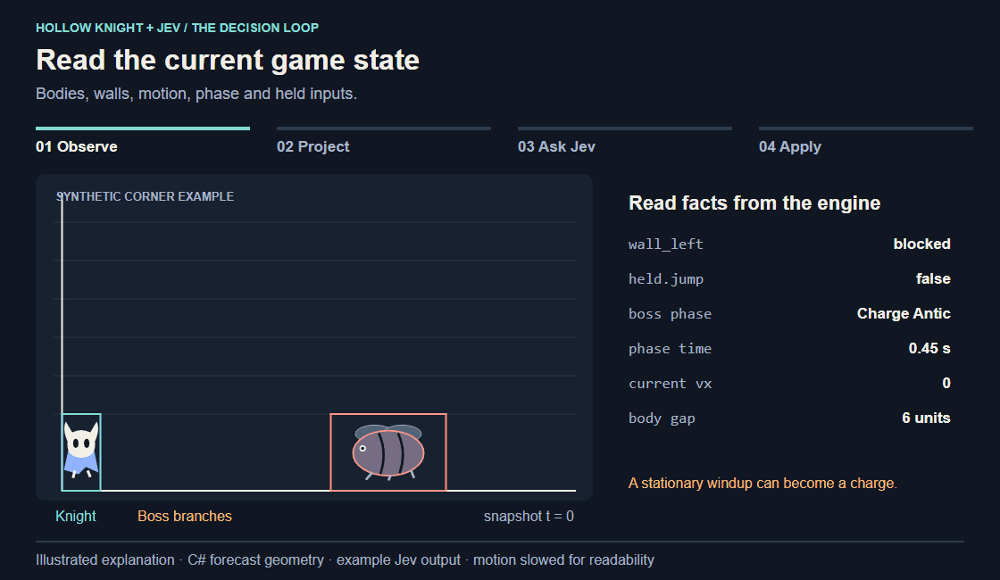

# Hollow Knight + Jev

**Jev chooses the next movement and nail strike from game state and short motion forecasts.**

Hollow Knight keeps moving while Jev is answering. This project gives it a compact description of the arena, the boss's current attack phase, and estimates of what could happen before and after its next input takes effect. Jev evaluates the available controls; a native bridge applies its choices as short button presses and holds.



*Illustrated example, slowed for readability. Geometry comes from the C# forecast on synthetic states; the Jev answer and probability bars are illustrative. [Static diagrams and the full walkthrough →](docs/HOW-IT-WORKS.md)*

## 1. Give Jev a useful description of the moment

The bridge reads collision bodies, positions, velocity, walls, attack phases, available abilities and held buttons directly from the game. The controller turns those measurements into a compact JSON state, with combat coordinates relative to the knight. This integration uses structured state as its model input; the illustrations below make that state visible to us.


A boss with zero velocity can still be winding up an attack. A held jump button can mean either a newly pressed jump or a button that needs releasing before another jump. Those details change what the next input can accomplish.

## 2. Account for the time between observation and action

The C# forecast compares possible knight controls with possible boss trajectories. It checks **0.7 seconds ahead**, in **20 ms steps**, under **100 ms and 180 ms input-delay assumptions**. Existing movement, pending jumps and measured nail recoil continue during that delay. The pictured paths use a 140 ms delay; contact metrics combine the two tested delays and all retained boss branches.


These are possible physical outcomes, not probabilities assigned to the boss's next RNG choice. For a slam windup, the code retains left/right launch possibilities and early/late phase timing. It sends Jev each control's projected clearance and contact timing, including exposure before the new input can begin. The forecast itself does not choose a control.

## 3. Let Jev choose movement and attack separately

One request contains the same state for two independent [Choice questions](https://docs.typesafe.ai/primitives/choice): **movement** and **strike**. Each has the goal, control mechanics and descriptions of its available options. Movement includes standing, walking and jump variants, plus dash when ready. Strike includes no attack or an available nail direction.


Jev returns a choice and a distribution over each question's options. Those probabilities describe **action choices**, not the chance of surviving or winning. The default grouped controller follows the returned choices, checks that the observation is still valid, and sends a button state lasting **at most 300 ms**. The next request can begin while that input is still active. A chosen nail strike is a **50 ms press**.

## Make a decision inspectable

The dashboard pairs the exact input and instructions with Jev's answer, probabilities, response time, selected buttons and the bridge's acknowledgement. That lets us examine the evidence available for a choice and see whether it was applied. Jev does not return a written rationale or a thought transcript; an explanation of a failure comes from comparing that evidence with the outcome.

The current experiment is Gruz Mother in Godhome. Its instructions prioritize avoiding hits and taking available nail openings, which can make combat too passive. More aggressive pursuit and better timing calibration are future experiments. The [walkthrough](docs/HOW-IT-WORKS.md) includes an actual forecast table, request fields, source pointers and the current model's limits.

This is a **source-only research prototype**. Bring your own game installation and TypeSafe API access. No game assets, game assemblies, save files, or API keys are included.

## Included

| Directory | Reusable component |
| --- | --- |
| `bridge/` | Unity state sensing, finite input leases, slot ownership checks, arena setup, hit and victory scoring |
| `patcher/` | Small Mono.Cecil patcher that audits the two inserted hooks and preserves original method bodies |
| `controller/` | .NET CLI, typed Jev requests, grouped combat, local forecasts, spending ledger, dashboard, offline regression tests |
| `scripts/` | Explicit local build, install, restore, launch, arena setup, and bounded paid trial commands |
| `examples/` | Synthetic state for inspecting a request without the game or an API key |

## Requirements

- Windows, PowerShell 7, .NET SDK 10.
- Steam Hollow Knight **1.5.12620**, with the supported vanilla `Assembly-CSharp.dll`. The build checks its SHA-256 and rejects other versions or already patched assemblies. See [installation](docs/INSTALLATION.md).
- An empty slot **4**, including no `user4*` local backup files. The harness refuses to adopt an existing personal save. Slots 1–3 are outside its control scope.
- A TypeSafe account for live trials. Offline commands need no key and make no provider requests.

## Start offline

From the repository root:

```powershell
dotnet build ./controller/JevController.csproj -c Release
dotnet ./controller/bin/Release/net10.0/JevController.dll self-test
dotnet ./controller/bin/Release/net10.0/JevController.dll budget-self-test
dotnet ./controller/bin/Release/net10.0/JevController.dll preview --state ./examples/synthetic-gruz.json --output ./artifacts/preview --scenario gruz-mother --decision-mode grouped --combat-compact true --danger-margin 2 --attack-mode pulse --model jev-1.13.0
```

The synthetic example is deliberately stale and cannot authorize live controls. The test suite uses fake HTTP responses and temporary state files; it never contacts Jev or starts Hollow Knight.

## Run your own experiment

Follow [installation and slot setup](docs/INSTALLATION.md) first. All paths are supplied by you; the scripts do not search neighboring projects or read `.env` files. Make `TYPESAFE_API_KEY` available in the process environment using your preferred secret manager. Never put a key in source code or a committed script.

With the owned slot in the paused Gruz Mother arena:

```powershell
./scripts/Run-Trial.ps1 -GameDirectory $game -Seconds 10 -MaxCalls 24 -MaxSpendUSD 0.05
```

That command is **paid**. It resumes the arena, makes a bounded run, then requests pause and latches STOP. Every run has a new private output directory and single-use budget ledger. For a longer, explicitly budgeted fight, choose the time, call count and cap yourself (hard ceilings: 600 seconds, 6,000 calls, $1 estimated input-token spend). These are local estimates at a pinned rate, **not a provider billing guarantee**; review [spending and data boundaries](docs/SECURITY.md).

The wrapper defaults to normal health. A native hit ends hitless verification. Optional training is explicitly separate and cannot produce a verified hitless result. No auto-retries or continuous background trial loop are provided.

To stop, use Ctrl+C in the controller or:

```powershell
./scripts/Setup-Trial.ps1 -GameDirectory $game -Action Stop
```

STOP is latched for the native game session; restart deliberately before another run. F8 also disables control when the game receives it. See [architecture and limitations](docs/ARCHITECTURE.md) for the observation contract and forecasting assumptions.

## Watch and replay locally

Use the output directory printed by `Run-Trial.ps1` as `$run`:

```powershell
dotnet ./controller/bin/Release/net10.0/JevController.dll watch --state "$game/.jev/runtime/state.json" --output $run --seconds 600
dotnet ./controller/bin/Release/net10.0/JevController.dll export --input "$run/trial-REPLACE-WITH-FILENAME.jsonl" --output ./artifacts/replay
```

The dashboard prints its temporary `127.0.0.1` URL. It is read-only and stops on Ctrl+C or timeout. Export makes an offline decision replay, not video. Replays omit screenshots, but still contain full local decision records; inspect them before sharing. Native game screenshots require explicit `-Capture` at launch and remain private generated output.

## Contributing and redistribution

Authored integration code is under the [MIT license](LICENSE). Hollow Knight, Unity, and third-party dependencies are separate products and are not included or relicensed here. This project is unaffiliated with Team Cherry and TypeSafe.

Build output can contain patched commercial game code and should not be redistributed. Fixes should first pass offline tests; do not spend API credits as part of an automated test or CI job.
