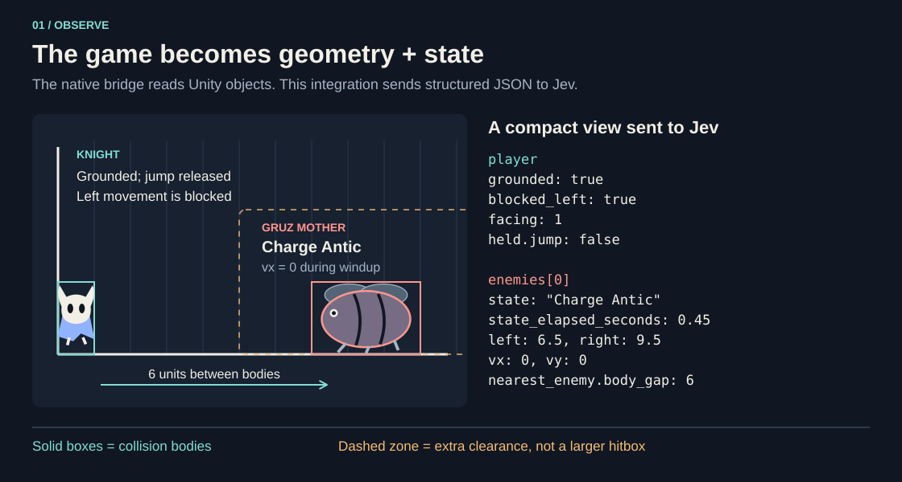
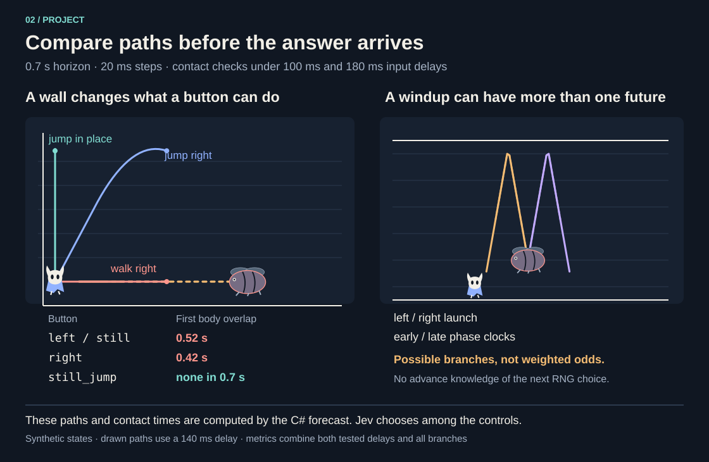
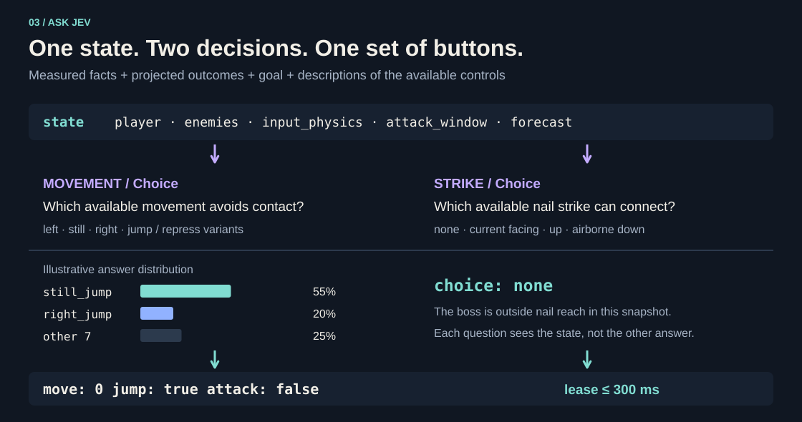

# How Jev plays Hollow Knight

The integration has three responsibilities: the native bridge measures and applies inputs, C# projects possible motion, and Jev chooses the controls. This guide follows the grouped Gruz Mother controller used by `Run-Trial.ps1`.

The diagrams use two [synthetic](../examples/corner-charge.json) [snapshots](../examples/slam-windup.json). Forecast positions and metrics were generated by the existing C# code. The pictured model answer and probabilities are illustrative, not a saved API response. The animation slows the projection down so its steps are readable.

## Observe: turn the arena into data



The bridge runs inside Unity on the main thread. It reads the knight's collision box, velocity, grounded state, facing, wall contact, attack readiness and held controls. For the boss it records collision geometry, velocity, state-machine phase, elapsed state time and animation timing. The full native snapshot stays local; the controller constructs a new object containing only the game facts needed for its questions.

In compact combat state, the knight's center is the origin: positive x is right and positive y is up. Bodies become `left`, `right`, `bottom` and `top` edges. Velocity and raw attack labels retain their meaning. This avoids asking the model to infer direction or distance from a screenshot.

The corner example supplies these facts:

| Field | Value | What the fact means |
| --- | --- | --- |
| `player.blocked_left` | `true` | A solid wall blocks horizontal movement to the left. |
| `held.jump` | `false` | Turning jump on can create a fresh press. |
| `enemies[0].state` | `Charge Antic` | The boss is in its charge windup. |
| `enemies[0].state_elapsed_seconds` | `0.45` | Time already spent in that phase; not a universal countdown. |
| `enemies[0].vx` | `0` | The boss is stationary now, before the charge. |
| `nearest_enemy.body_gap` | `6` | Current separation of the actual collision bodies, in world units. |

There are three different geometries to keep separate. The **body** is the measured collision shape. The **avoidance zone** expands it by a configured clearance margin, currently two units in the wrapper. The forecast also uses a separate **0.15-unit modelling tolerance** for `first_contact_seconds`. A tolerance or zone breach is not automatically a damaging body overlap. Nail reach uses the actual body, not the expanded zone.

Source: [`BossTrial.Capture`](../bridge/BossTrial.cs), [`CombatState` / `CompactCombatState`](../controller/Program.cs), [`InputPhysicsState`](../controller/InputPhysics.cs).

## Project: consider the moment when the input can matter

The game continues during request preparation, network transit, inference and command delivery. A plan based only on where the boss was when the snapshot was taken may already be late when the button reaches the game.

The forecast preserves existing input and motion during an assumed delay, then simulates each candidate control. It uses 20 ms steps over 0.7 seconds. Contact summaries check both 100 ms and 180 ms delays; the example path samples use 140 ms. These numbers are configured assumptions in this version, not a guarantee or measurement of Jev's response time. Actual request timing is logged as `response_ms`.

For each enemy, the code retains the motion branches supported by its current phase:

- **Charge:** project the committed charge direction, including windup, a wall rebound and recovery.
- **Slam windup:** retain both initial horizontal launch directions. Charge and slam projections also use early/late phase-clock hypotheses at ±40 ms.
- **Committed slam:** follow the current direction, arena impacts and measured pauses. At the measured end of powered flight, retain decaying momentum.
- **Other phases:** extend observed drift without claiming knowledge of an unknown future state transition.

The native animation shape catalog, when supplied, changes the projected boss bounds over time. The synthetic fixtures use simple fixed bodies. Knight paths account for walls, gravity, jump press/hold/release semantics, available dash, existing recoil and other measured motion state.



The **corner-charge** fixture produces the following real offline forecast. Each clearance is the minimum across the retained boss branches and both tested delays:

| Candidate | First body overlap | Minimum body clearance |
| --- | --- | --- |
| `left` | 0.52 s | −1.00 |
| `still` | 0.52 s | −1.00 |
| `right` | 0.42 s | −1.80 |
| `still_jump` | none within 0.7 s | +2.65 |
| `right_jump` | none within 0.7 s | +1.86 |

Negative clearance means overlapping bodies. `null` for an overlap time means no overlap found within this finite horizon, not indefinite safety. A body-overlap forecast is also not an observed game hit.

Moving left has the same result as staying still here because the wall prevents translation. Walking right closes the gap sooner. Jumping gives useful vertical clearance. These are the facts Jev can compare; the C# forecast does not replace the model with an algorithm that picks the best row.

**There is no probability weight on these enemy branches.** Worst-case clearance, first contact and post-input overlap duration summarize the retained possibilities. A long overlap duration is not an estimated likelihood. The model also sees `pre_input_body_overlap_seconds` and post-input metrics so it can distinguish danger before a new control is available from the escape it can still attempt afterward.

Source: [`BossPaths`, `KnightPath`, `Forecast`](../controller/Forecast.cs), [`ForecastForModel`](../controller/InputPhysics.cs).

## Ask: a shared state and two bounded judgments

The request's `state` combines measurements with those derived forecasts. `questions` provides the goal and the meaning of each available control. The grouped movement question begins with the goal to defeat Gruz Mother without being hit; its instructions explain input delay, walls, jump semantics, dash and the difference between proximity and overlap. The strike question asks for a reachable nail direction or `none`.

Both questions are sent together and evaluated independently over the same state. They do not see each other's answers. In particular, the strike question cannot assume the movement choice will turn the knight first. It uses the measured facing direction. [TypeSafe's state documentation](https://docs.typesafe.ai/concepts/state) describes this shared-state contract.



Available movement choices include left/still/right with ordinary jump and release-and-repress variants. Dash is offered only when native telemetry says it is ready. Available strike directions include the currently faced horizontal direction, up, and down while airborne. Nail is the only connected weapon. These options describe input mechanics, not a prewritten route or boss-fight sequence.

Here is an **abridged state excerpt** generated from the corner fixture:

```json
{
  "player": { "grounded": true, "blocked_left": true, "facing": 1 },
  "held": { "move": 0, "look": 0, "jump": false, "attack": false },
  "input_physics": { "jump_phase": "released" },
  "forecast": {
    "horizon_seconds": 0.7,
    "control_delay_seconds": [0.1, 0.18],
    "movement_outcomes": {
      "left": {
        "minimum_body_clearance": -1,
        "first_body_overlap_seconds": 0.52
      },
      "still_jump": {
        "minimum_body_clearance": 2.65,
        "first_body_overlap_seconds": null
      }
    }
  }
}
```

The full request also contains enemy geometry, all available movement outcomes, attack-window geometry, control availability, instructions and criteria. Read the [full generated request](../examples/corner-charge-request.json) directly, or print it from the repository root without an API key or game:

```powershell
dotnet build ./controller/JevController.csproj -c Release
dotnet ./controller/bin/Release/net10.0/JevController.dll preview --state ./examples/corner-charge.json --output ./artifacts/preview --scenario gruz-mother --decision-mode grouped --combat-compact true --danger-margin 2 --attack-mode pulse
```

Replace the state path with `./examples/slam-windup.json` to see four slam branches: left/right launch, each with early/late timing. Both fixtures are deliberately stale and have control disabled.

A [Choice response](https://docs.typesafe.ai/primitives/choice) supplies the selected option and a distribution across the question's options. The diagram's 55% `still_jump`, 20% `right_jump` and 25% other choices are **illustrative**, not measured model output. They demonstrate how a response is displayed. They do not mean a 55% chance of dodging, winning or predicting the boss's next action. [Choice confidence](https://docs.typesafe.ai/confidence) describes the distribution's concentration; it does not establish that a game action is correct.

Source: [`GroupedCombatRequest`, `SelectedGroupedAction`](../controller/GroupedCombat.cs).

## Apply: short inputs with a fresh-state check

For an illustrative response of `movement: still_jump` and `strike: none`, composition yields:

```json
{ "move": 0, "look": 0, "jump": true, "attack": false, "duration_ms": 300 }
```

This is a button-state excerpt. The real command also carries a session, observation sequence, ID and timestamp. The controller rechecks current state before publishing. The native bridge validates the command and reports whether it was applied. Stale, paused, stopped or wrong-session work is rejected. No tactical fallback silently substitutes another dodge.

An input lasts at most 300 ms or until replaced; a chosen nail strike is a 50 ms pulse. After acknowledgement, the next model evaluation can start while the previous lease is active. If no new valid command arrives, the old input expires. The 0.7-second forecast assumes renewed intent beyond that lease; it is not a 0.7-second unattended action script.

Source: [`RunAsync`, `Command`, `CanApply`](../controller/Program.cs), [`Bridge`](../bridge/Bridge.cs).

## What a visual explanation can establish

A useful decision review puts four things next to one another: the exact observation and forecast, the instructions and options, the returned choices/probabilities, and the actual native outcome. The dashboard and local records preserve that chain. This lets us find missing telemetry, an inaccurate motion model, a poor model choice, or an action that arrived too late.

Jev supplies typed judgments, not a prose explanation or internal thought trace. Saying "the corner offered no horizontal escape" describes evidence in the input. It is not a quotation of Jev's reasoning.

Several limits remain useful to keep in view. These are sampled approximations, with fixed delay hypotheses and a short horizon. Later unknown RNG transitions, new strike recoil and exact wall-slide locks are not fully modelled. The current movement instructions favor safety and limited displacement, which can suppress pursuit. Improving aggression, delay estimates and branch accuracy are separate experiments; this visual documentation does not change the controller's behavior.
